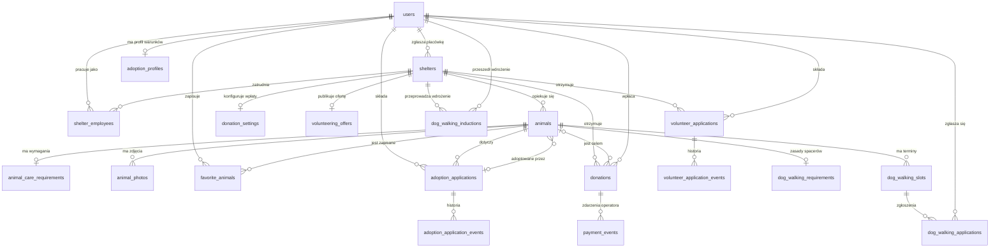

# Diagram bazy danych

Typy na diagramie są opisowe, w SQLite wszystkie mapują się na `INTEGER` albo `TEXT`:

| Na diagramie | W SQLite | Uwagi |
|---|---|---|
| `int` | `INTEGER` | PK `INTEGER PRIMARY KEY`, kwoty w groszach |
| `bool` | `INTEGER` | `CHECK (x IN (0, 1))` |
| `text` | `TEXT` | enumy jako `TEXT` + `CHECK (x IN (...))`, wartości w komentarzu |
| `datetime` | `TEXT` | ISO-8601 UTC, np. `2026-10-28T12:00:00Z` |
| `json` | `TEXT` | lista lub obiekt zapisany jako JSON (`json.dumps`) |

`NULL` w komentarzu oznacza kolumnę opcjonalną. Pozostałe kolumny są `NOT NULL`.

## 1. Przegląd relacji

Kolumny audytowe wskazujące użytkownika (`blocked_by`, `decided_by`, `updated_by`, `recorded_by` itp.) pominięto tutaj dla czytelności. Są w diagramie szczegółowym.



## 2. Diagram szczegółowy

```mermaid
erDiagram
    %% ============ Identity ============
    users {
        int id PK
        text email UK
        text password_hash
        text first_name
        text last_name
        text phone "NULL, BR-050 telefon opcjonalny"
        bool is_admin
        text status "Active, Blocked, Anonymized"
        text blocked_reason "NULL"
        datetime blocked_at "NULL"
        int blocked_by FK "NULL, users.id"
        datetime anonymized_at "NULL"
        datetime created_at
        datetime updated_at
    }

    %% ============ Shelter ============
    shelters {
        int id PK
        text name
        text description
        text street_address
        text postal_code
        text city
        text voivodeship "BR-002, BR-014, BR-015"
        text contact_email
        text contact_phone "NULL"
        text website "NULL"
        text adoption_rules
        text status "Pending, Approved, Rejected, Blocked"
        int submitted_by FK "users.id"
        datetime submitted_at
        int decided_by FK "NULL, admin"
        datetime decided_at "NULL"
        text rejection_reason "NULL"
        text blocked_reason "NULL"
        datetime blocked_at "NULL"
        int blocked_by FK "NULL, admin"
        datetime last_reminder_at "NULL, BR-046 max raz w tygodniu"
        datetime created_at
        datetime updated_at
    }

    shelter_employees {
        int shelter_id PK, FK
        int user_id PK, FK
        bool is_manager "zarzadza personelem i wplatami"
        int assigned_by FK "users.id"
        datetime assigned_at
    }

    %% ============ Animal ============
    animals {
        int id PK
        int shelter_id FK
        text name
        text species "Dog, Cat"
        text sex "Male, Female, Unknown"
        text breed "NULL"
        int age_min_months "NULL, przedzial wieku BR-016"
        int age_max_months "NULL"
        text size "NULL, Small, Medium, Large"
        text description "charakter"
        text daily_needs "BR-007"
        text temperament "NULL, tagi CSV"
        text status "Draft, Available, AdoptionInProgress, Adopted, Withdrawn"
        text withdrawn_reason "NULL"
        bool is_hidden "moderacja, niezalezna od status"
        text hidden_reason "NULL"
        datetime hidden_at "NULL"
        int hidden_by FK "NULL, admin"
        datetime published_at "NULL, sortowanie BR-019"
        datetime last_confirmed_at "NULL, BR-044"
        int last_confirmed_by FK "NULL, users.id"
        bool donations_enabled "BR-060"
        int adoption_application_id FK "NULL, zgloszenie w procesie lub zakonczone adopcja"
        text adoption_type "NULL, Portal, External"
        datetime adopted_at "NULL"
        text adoption_notes "NULL"
        datetime created_at
        datetime updated_at
    }

    animal_care_requirements {
        int animal_id PK, FK
        text good_with_children "Yes, No, Unknown - BR-010"
        text good_with_dogs "Yes, No, Unknown"
        text good_with_cats "Yes, No, Unknown"
        text activity_level "NULL, Low, Medium, High"
        text min_experience "NULL, None, Basic, Experienced"
        text special_care_required "Yes, No, Unknown"
        text special_care_notes "NULL"
        text notes_to_discuss "NULL, BR-009"
        int updated_by FK "users.id"
        datetime updated_at
    }

    animal_photos {
        int id PK
        int animal_id FK
        text file_path
        text alt_text "NULL"
        int position
        bool is_main
        int uploaded_by FK "users.id"
        datetime created_at
    }

    %% ============ Adoption ============
    favorite_animals {
        int user_id PK, FK
        int animal_id PK, FK
        datetime created_at
    }

    adoption_profiles {
        int user_id PK, FK
        bool has_children "NULL = brak odpowiedzi, BR-024"
        bool has_dogs "NULL"
        bool has_cats "NULL"
        text experience "NULL, None, Basic, Experienced"
        text activity_level "NULL, Low, Medium, High"
        bool special_care_ready "NULL"
        text additional_info "NULL"
        int questionnaire_version
        datetime updated_at
    }

    adoption_applications {
        int id PK
        int animal_id FK
        int shelter_id FK "kopia z animals, uprawnienia i listy"
        int applicant_id FK "users.id"
        text status "Submitted, InContact, Withdrawn, ClosedWithoutAdoption, Adopted"
        text message "NULL"
        text contact_name "kopia z chwili wyslania, BR-034"
        text contact_email
        text contact_phone "NULL"
        json profile_snapshot "BR-041"
        json requirements_snapshot "BR-041"
        json match_snapshot "lista kryterium, kategoria, wyjasnienie"
        int match_rules_version "BR-033"
        datetime submitted_at
        datetime closed_at "NULL"
        datetime updated_at
    }

    adoption_application_events {
        int id PK
        int application_id FK
        text type "StatusChange, Message"
        text from_status "NULL"
        text to_status "NULL"
        text message "NULL, wiadomosc dla kandydata"
        int author_id FK "NULL = system"
        datetime created_at
    }

    %% ============ Donation ============
    donation_settings {
        int shelter_id PK, FK
        text recipient_name "podmiot otrzymujacy srodki, BR-054"
        text provider_recipient_id "ID odbiorcy u operatora"
        json suggested_amounts "grosze, np. [1000, 3000, 5000]"
        int min_amount "grosze"
        int max_amount "NULL, grosze"
        bool allow_custom_amount
        text terms_text "zasady wsparcia"
        int terms_version
        text support_contact "kontakt ws. zwrotow, BR-061"
        text fees_info "prowizje operatora, BR-054"
        bool enabled
        int enabled_by FK "NULL, tylko admin, nadzor z sekcji 4.4"
        datetime enabled_at "NULL"
        text disabled_reason "NULL"
        datetime disabled_at "NULL"
        bool stats_public "BR-059"
        int updated_by FK "users.id"
        datetime updated_at
    }

    donations {
        int id PK
        int user_id FK
        int shelter_id FK
        int animal_id FK "NULL = wsparcie calej placowki"
        int amount "grosze, PLN"
        text status "Pending, Succeeded, Failed, Cancelled, PartiallyRefunded, Refunded"
        int refunded_amount "grosze, suma zwrotow"
        text provider_payment_id UK "NULL do czasu utworzenia platnosci"
        text recipient_name "kopia z chwili wplaty"
        int terms_version "kopia z chwili wplaty"
        datetime created_at
        datetime confirmed_at "NULL, pierwsze Succeeded, data do statystyk"
        datetime updated_at
    }

    payment_events {
        int id PK
        text provider_event_id UK "deduplikacja, AC-025"
        int donation_id FK
        text status
        int refunded_amount "skumulowana suma"
        datetime occurred_at
        datetime received_at
    }

    %% ============ Volunteering ============
    volunteering_offers {
        int shelter_id PK, FK
        text description
        json forms_of_help "lista form pomocy"
        text requirements
        text age_rules "BR-062"
        text onboarding_info
        text contact_info "BR-062"
        bool recruitment_open
        datetime recruitment_changed_at "NULL"
        int updated_by FK "users.id"
        datetime updated_at
    }

    volunteer_applications {
        int id PK
        int shelter_id FK
        int applicant_id FK "users.id"
        text status "Submitted, InContact, Accepted, Rejected, Withdrawn, Ended"
        json preferred_forms "BR-063"
        text availability "opis tekstowy"
        text experience "NULL"
        text message "NULL"
        text contact_name
        text contact_email
        text contact_phone "NULL"
        bool rules_accepted "oswiadczenie BR-063"
        bool age_confirmed "oswiadczenie zamiast daty urodzenia, BR-050"
        text instructions "NULL, ustawiane przy akceptacji"
        datetime submitted_at
        datetime closed_at "NULL"
        datetime updated_at
    }

    volunteer_application_events {
        int id PK
        int application_id FK
        text type "StatusChange, Message"
        text from_status "NULL"
        text to_status "NULL"
        text message "NULL"
        int author_id FK "NULL = system"
        datetime created_at
    }

    %% ============ DogWalking ============
    dog_walking_requirements {
        int animal_id PK, FK
        bool enabled
        int min_age
        text min_experience "None, Basic, Experienced"
        bool induction_required
        bool volunteer_required "zaakceptowany wolontariusz, BR-067"
        text additional_requirements "NULL"
        int updated_by FK "users.id"
        datetime updated_at
    }

    dog_walking_inductions {
        int id PK
        int shelter_id FK
        int user_id FK
        datetime completed_at
        int recorded_by FK "pracownik"
        text notes "NULL"
    }

    dog_walking_slots {
        int id PK
        int animal_id FK
        int shelter_id FK "kopia z animals"
        datetime starts_at
        datetime ends_at
        text meeting_point
        text instructions "NULL"
        text status "Open, Reserved, Vacated, Cancelled, Completed, NoShow"
        text cancel_reason "NULL"
        int cancelled_by FK "NULL, NULL = system"
        datetime cancelled_at "NULL"
        text outcome_notes "NULL"
        int outcome_recorded_by FK "NULL, users.id"
        datetime outcome_recorded_at "NULL"
        int created_by FK "users.id"
        datetime created_at
        datetime updated_at
    }

    dog_walking_applications {
        int id PK
        int slot_id FK
        int applicant_id FK "users.id"
        text status "Pending, Accepted, Rejected, Withdrawn, SlotTaken, CancelledByShelter, Completed, NoShow"
        text message "NULL"
        text contact_name "kopia, BR-069"
        text contact_email
        text contact_phone "NULL"
        bool age_confirmed "zamiast daty urodzenia"
        text declared_experience "None, Basic, Experienced"
        bool requirements_accepted
        text decision_reason "NULL"
        int decided_by FK "NULL, users.id"
        datetime decided_at "NULL"
        datetime created_at
        datetime updated_at
    }

    %% ============ Relacje ============
    users ||--o{ shelters : "submitted_by"
    users ||--o{ shelter_employees : "user_id"
    shelters ||--o{ shelter_employees : "shelter_id"

    shelters ||--o{ animals : "shelter_id"
    animals ||--o| animal_care_requirements : "animal_id"
    animals ||--o{ animal_photos : "animal_id"

    users ||--o{ favorite_animals : "user_id"
    animals ||--o{ favorite_animals : "animal_id"
    users ||--o| adoption_profiles : "user_id"
    users ||--o{ adoption_applications : "applicant_id"
    animals ||--o{ adoption_applications : "animal_id"
    shelters ||--o{ adoption_applications : "shelter_id"
    adoption_applications ||--o{ adoption_application_events : "application_id"
    users |o--o{ adoption_application_events : "author_id"
    animals }o--o| adoption_applications : "adoption_application_id"

    shelters ||--o| donation_settings : "shelter_id"
    shelters ||--o{ donations : "shelter_id"
    animals |o--o{ donations : "animal_id"
    users ||--o{ donations : "user_id"
    donations ||--o{ payment_events : "donation_id"

    shelters ||--o| volunteering_offers : "shelter_id"
    shelters ||--o{ volunteer_applications : "shelter_id"
    users ||--o{ volunteer_applications : "applicant_id"
    volunteer_applications ||--o{ volunteer_application_events : "application_id"
    users |o--o{ volunteer_application_events : "author_id"

    animals ||--o| dog_walking_requirements : "animal_id"
    animals ||--o{ dog_walking_slots : "animal_id"
    shelters ||--o{ dog_walking_slots : "shelter_id"
    dog_walking_slots ||--o{ dog_walking_applications : "slot_id"
    users ||--o{ dog_walking_applications : "applicant_id"
    shelters ||--o{ dog_walking_inductions : "shelter_id"
    users ||--o{ dog_walking_inductions : "user_id"
```



## 3. Ograniczenia, których diagram nie pokazuje

Wszystkie poniższe konstrukcje działają w SQLite (częściowe indeksy od wersji 3.8). Pamiętaj o `PRAGMA foreign_keys = ON;` przy każdym połączeniu, bo SQLite domyślnie nie sprawdza kluczy obcych.

### Identity i Shelter

| Ograniczenie | SQL | Źródło |
|---|---|---|
| Unikalny e-mail bez względu na wielkość liter | `email TEXT NOT NULL UNIQUE COLLATE NOCASE` | RegisterUser |
| Status użytkownika | `CHECK (status IN ('Active','Blocked','Anonymized'))` | BlockUser, AnonymizeUserAccount |
| Powód przy blokadzie | `CHECK (status <> 'Blocked' OR blocked_reason IS NOT NULL)` | BR-048 |
| Powód przy odrzuceniu placówki | `CHECK (status <> 'Rejected' OR rejection_reason IS NOT NULL)` | RejectShelterRegistration |
| Jeden pracownik raz w danej placówce | PK `(shelter_id, user_id)` | AssignShelterEmployee |

### Animal

| Ograniczenie | SQL | Źródło |
|---|---|---|
| Spójny przedział wieku | `CHECK (age_min_months IS NULL OR age_max_months IS NULL OR age_min_months <= age_max_months)` | BR-016 |
| Dane adopcji tylko dla adoptowanych | `CHECK (status <> 'Adopted' OR (adopted_at IS NOT NULL AND adoption_type IS NOT NULL))` | CompleteAnimalAdoption |
| Adopcja przez portal wymaga zgłoszenia | `CHECK (adoption_type <> 'Portal' OR adoption_application_id IS NOT NULL)` | PortalAdoption |
| Jedno zdjęcie główne | `CREATE UNIQUE INDEX ux_photo_main ON animal_photos(animal_id) WHERE is_main = 1;` | BR-018 |
| Wyszukiwarka | `CREATE INDEX ix_animals_search ON animals(status, is_hidden, species, size);` | SearchAnimals |

Filtr wieku (BR-016) to sprawdzenie części wspólnej przedziałów: `age_min_months <= :max AND age_max_months >= :min`. Karta jest widoczna publicznie, gdy `status IN ('Available','AdoptionInProgress') AND is_hidden = 0` i placówka ma `status = 'Approved'`. Oznaczenie „wymaga potwierdzenia” wynika z `last_confirmed_at < now - 30 dni` i nie jest zapisywane w bazie.

### Adoption

| Ograniczenie | SQL | Źródło |
|---|---|---|
| Najwyżej jedno niezakończone zgłoszenie osoby do zwierzęcia | `CREATE UNIQUE INDEX ux_adoption_active ON adoption_applications(applicant_id, animal_id) WHERE status IN ('Submitted','InContact');` | RB-008, AC-011 |
| Polubienie bez duplikatów, operacja idempotentna | PK `(user_id, animal_id)` + `INSERT OR IGNORE` | AddAnimalToFavorites |
| Kompletny wpis historii | `CHECK (type <> 'StatusChange' OR to_status IS NOT NULL)` | BR-038 |

Każda zmiana `adoption_applications.status` to w jednej transakcji `UPDATE` zgłoszenia i `INSERT` do `adoption_application_events`.

### Donation

| Ograniczenie | SQL | Źródło |
|---|---|---|
| Dodatnia kwota | `CHECK (amount > 0)` | BR-053 |
| Zwrot nie większy niż wpłata | `CHECK (refunded_amount BETWEEN 0 AND amount)` | BR-059 |
| Jedna wpłata na płatność u operatora | `provider_payment_id TEXT UNIQUE` | AC-025 |
| Jedno zdarzenie operatora zastosowane raz | `provider_event_id TEXT NOT NULL UNIQUE` + `INSERT OR IGNORE`; gdy nic nie wstawiono, zakończ bez zmian | AC-025 |
| Spójne limity | `CHECK (max_amount IS NULL OR max_amount >= min_amount)` | ConfigureShelterDonationSettings |

Statystyki (BR-059) liczone zapytaniem, bez osobnej tabeli:

```sql
SELECT SUM(amount - refunded_amount)                      AS total,
       COUNT(*)                                           AS donations_count,
       COUNT(DISTINCT user_id)                            AS supporters_count
FROM donations
WHERE shelter_id = :shelter_id            -- albo animal_id = :animal_id
  AND status IN ('Succeeded', 'PartiallyRefunded')        -- pomija Refunded, Pending, Failed
  AND confirmed_at >= :from AND confirmed_at < :to;
```

`COUNT(DISTINCT user_id)` działa także po anonimizacji, bo wiersz użytkownika zostaje (ze statusem `Anonymized`), a dane osobowe są czyszczone. Patrz README, decyzja D3.

### Volunteering

| Ograniczenie | SQL | Źródło |
|---|---|---|
| Najwyżej jedno aktywne zgłoszenie osoby do placówki | `CREATE UNIQUE INDEX ux_volunteer_active ON volunteer_applications(applicant_id, shelter_id) WHERE status IN ('Submitted','InContact','Accepted');` | BR-065, AC-032 |
| Oświadczenia przy wysyłce | `CHECK (rules_accepted = 1 AND age_confirmed = 1)` | BR-063 |
| Instrukcje przy akceptacji | `CHECK (status <> 'Accepted' OR instructions IS NOT NULL)` | AcceptVolunteerApplication |

### DogWalking

| Ograniczenie | SQL | Źródło |
|---|---|---|
| Koniec po początku | `CHECK (ends_at > starts_at)` | PublishDogWalkingSlot |
| Najwyżej jedna zaakceptowana osoba na termin, także przy równoczesnych akceptacjach | `CREATE UNIQUE INDEX ux_walk_accepted ON dog_walking_applications(slot_id) WHERE status = 'Accepted';` | RB-021, AC-036 |
| Jedno aktywne zgłoszenie osoby na termin | `CREATE UNIQUE INDEX ux_walk_active ON dog_walking_applications(slot_id, applicant_id) WHERE status IN ('Pending','Accepted');` | BR-069 |
| Potwierdzenie wymagań | `CHECK (requirements_accepted = 1)` | BR-069 |
| Jedno wdrożenie osoby w placówce | `UNIQUE (shelter_id, user_id)` | luka G-17 |

Nakładanie się terminów psa (RB-022, AC-034) i zaakceptowanych spacerów użytkownika (AC-037) sprawdza command w tej samej transakcji, przed `INSERT`/`UPDATE`:

```sql
-- PublishDogWalkingSlot: czy pies ma już aktywny termin w tym czasie?
SELECT 1 FROM dog_walking_slots
WHERE animal_id = :animal_id
  AND status IN ('Open', 'Reserved', 'Vacated')
  AND starts_at < :ends_at AND ends_at > :starts_at
LIMIT 1;

-- AcceptDogWalkingApplication: czy użytkownik ma już zaakceptowany spacer w tym czasie?
SELECT 1 FROM dog_walking_applications a
JOIN dog_walking_slots s ON s.id = a.slot_id
WHERE a.applicant_id = :user_id AND a.status = 'Accepted'
  AND s.starts_at < :ends_at AND s.ends_at > :starts_at
LIMIT 1;
```

Porównywanie dat jako tekstu działa tylko wtedy, gdy wszystkie daty mają ten sam format ISO-8601 w UTC.

`database.py` wysyła zwykłe `BEGIN` (transakcja odroczona). Przy dwóch równoczesnych zapisach SQLite i tak nie dopuści obu, ale drugi dostanie błąd `database is locked` dopiero przy zapisie. Czytelniej jest dla widoków `@page(..., write=True)` wysyłać `BEGIN IMMEDIATE`: blokada zapisu zostaje wtedy założona od razu, a sprawdzenie i zapis wykonują się bez przeplotu z innym zapisem.

### Warunki sprawdzane przy zapisie zamiast flag

Blokada placówki i ukrycie karty **nie zerują** flag `donations_enabled`, `donation_settings.enabled` ani `recruitment_open` (README, D13). Dzięki temu odblokowanie przywraca dokładnie poprzedni stan. Każdy command, który zaczyna nową aktywność, sprawdza:

| Command | Warunek |
|---|---|
| `StartDonation` | `shelters.status = 'Approved'` AND `donation_settings.enabled = 1`; dla zwierzęcia także `animals.status IN ('Available','AdoptionInProgress') AND is_hidden = 0 AND donations_enabled = 1` |
| `SubmitAdoptionApplication` | `shelters.status = 'Approved'` AND `animals.status = 'Available' AND is_hidden = 0` (RB-003, BR-020) |
| `SubmitVolunteerApplication` | `shelters.status = 'Approved'` AND `volunteering_offers.recruitment_open = 1` |
| `PublishDogWalkingSlot`, `ApplyForDogWalkingSlot` | `shelters.status = 'Approved'` AND `animals.is_hidden = 0 AND status IN ('Available','AdoptionInProgress')` AND `dog_walking_requirements.enabled = 1` |
| `PublishAnimalProfile` | `shelters.status = 'Approved'` (RB-001) |

Widoki publiczne używają tych samych warunków. Najprościej trzymać je w jednym miejscu, np. jako fragmenty SQL w module `operations/common.py`.